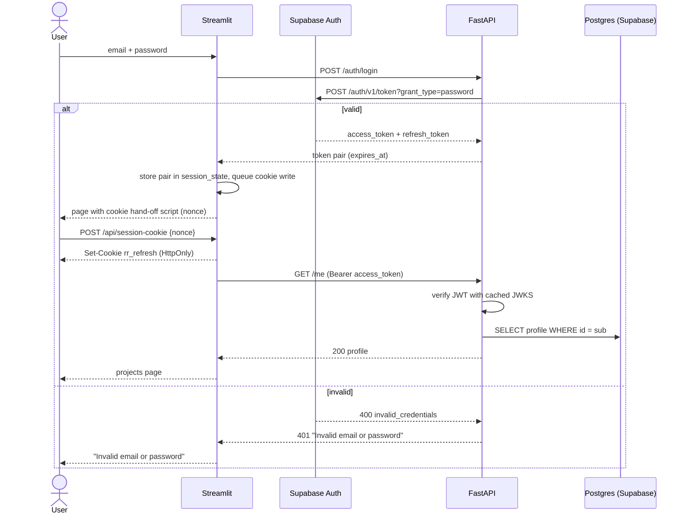
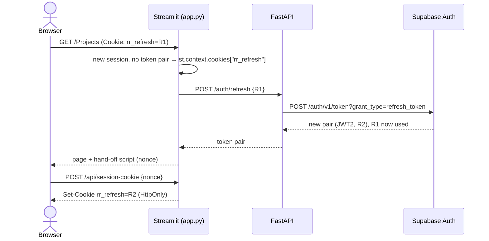
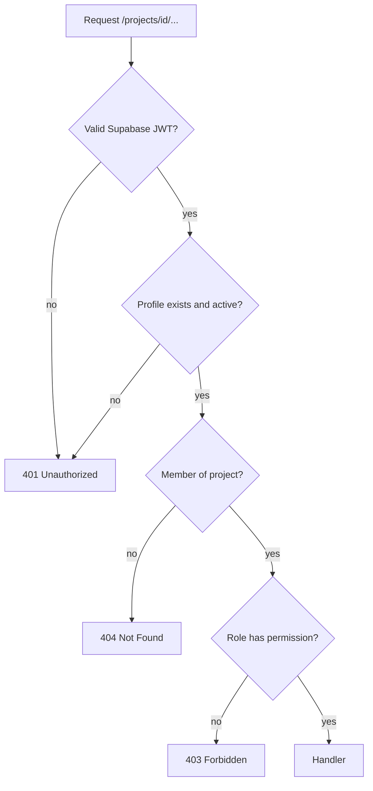

# ReviewRadar – Authentication and Roles

Covers Trello stories #1 (log in), #2 (create project), #3 (manage project roles).
Requirements: FR01, FR02, FR09, NFR01.

**Authentication = Supabase Auth. Authorization (roles) = FastAPI + `project_members`.**

## 1. Roles

There is **no platform-wide admin role**. Every registered account is a regular user who can create projects; all access is decided by the role the user has inside a project.

| Level | Role | Stored in | Who |
|-------|------|-----------|-----|
| Platform | user | `profiles` | Any registered account. Can create projects. |
| Project | `owner` | `project_members.role` | Creator of the project, or promoted by an owner. Manages members, roles, categories, project settings. |
| Project | `analyst` | `project_members.role` | Imports, adds, searches, filters reviews; starts analysis; corrects labels. |
| Project | `product_manager` | `project_members.role` | Monitors dashboard and recurring issues; creates and updates issues; exports. |
| Project | `viewer` | `project_members.role` | Read-only access to reviews and dashboard. |

A user without a `project_members` row has **no access** to that project.

## 2. Permission matrix

| Action | owner | analyst | product_manager | viewer |
|--------|:-----:|:-------:|:---------------:|:------:|
| View project, reviews, dashboard | ✓ | ✓ | ✓ | ✓ |
| Rename / edit project description | ✓ | | | |
| Archive project | ✓ | | | |
| Add / remove members, change roles | ✓ | | | |
| Manage categories | ✓ | | | |
| Import CSV, add review manually | ✓ | ✓ | | |
| Start / retry analysis | ✓ | ✓ | | |
| Correct sentiment label | ✓ | ✓ | | |
| Create / update issues | ✓ | | ✓ | |
| Export results | ✓ | ✓ | ✓ | |
| View correction history / audit log | ✓ | | | |

Permissions are defined once in code as a mapping, not spread across endpoints:

```python
PERMISSIONS = {
    "project.read":     {"owner", "analyst", "product_manager", "viewer"},
    "project.update":   {"owner"},
    "members.manage":   {"owner"},
    "categories.manage":{"owner"},
    "reviews.write":    {"owner", "analyst"},
    "analysis.run":     {"owner", "analyst"},
    "issues.write":     {"owner", "product_manager"},
    "results.export":   {"owner", "analyst", "product_manager"},
    "audit.read":       {"owner"},
}
```

## 3. Business rules

1. Creating a project inserts the project and an `owner` membership for the creator in **one transaction**.
2. A project always has **at least one owner**. Demoting the last owner returns `409 Conflict` (make another member owner first).
3. Members join through **invitations**: an owner invites an email with a role, and the invitee accepts in the Notifications tab. See [invite-system.md](invite-system.md).
4. A user cannot be added twice to the same project (`409`).
5. Any member can leave a project. When the **last owner leaves**, the member who joined the project first (oldest `project_members.created_at`) is promoted to `owner` in the same transaction, logged as `member.role_changed` with `reason: "last_owner_left"`. If the owner is the only member, leaving returns `409`; archive the project instead. The UI shows a warning naming the member who will be promoted before the owner confirms.
6. Non-members get `404 Not Found` for a project (does not reveal it exists). Members without the needed permission get `403 Forbidden`.
7. Archived projects are read-only for everyone.
8. Every membership change writes an `audit_log` row (`member.added`, `member.role_changed`, `member.removed`).

## 4. Authentication (Supabase Auth)

Supabase owns accounts, passwords, password reset and sessions.
The app never stores or sees password hashes. **FastAPI is the only client of Supabase Auth**: Streamlit signs in, refreshes and signs out through FastAPI `/auth/*` endpoints, and holds no Supabase key.

| Item | Choice |
|------|--------|
| Provider | Supabase Auth, email + password. OAuth (Google, GitHub) can be enabled later in the dashboard without FastAPI changes. |
| Sign-up / sign-in | Streamlit → FastAPI `POST /auth/signup` / `POST /auth/login` → Supabase Auth REST (`/auth/v1/signup`, `/auth/v1/token?grant_type=password`) with the **publishable (anon) key**. Returns the token pair. |
| Access token | Supabase JWT: `sub` = `auth.users.id` (UUID), `aud = "authenticated"`, lifetime `jwt_expiry` = 1 h. Kept only in `st.session_state` (server memory). |
| Refresh token | Opaque Supabase refresh token, **single-use** (`enable_refresh_token_rotation = true`, reuse window 10 s). Exchanged at `POST /auth/refresh` 60 s before the access token expires; every refresh returns a new pair. |
| Session persistence | The refresh token is mirrored into an **HttpOnly, SameSite=Strict** cookie `rr_refresh` (`Secure` on HTTPS, `Max-Age` = `SESSION_COOKIE_DAYS`, default 7, renewed on each rotation). A reload or new tab restores the session from it, see below. |
| Verification in FastAPI | Signature checked against the project JWKS `<SUPABASE_URL>/auth/v1/.well-known/jwks.json` (asymmetric signing keys); `exp` and `aud` checked. Legacy HS256 projects: verify with `SUPABASE_JWT_SECRET` instead. |
| Transport | `Authorization: Bearer <access_token>` from Streamlit to FastAPI |
| App user record | `public.profiles`, created by trigger on `auth.users` insert ([schema.sql](database/schema.sql)) |
| Email confirmation | **Not required.** "Confirm email" is off (Dashboard → Authentication → Providers → Email; locally `enable_confirmations = false`), so Supabase marks the email confirmed at sign-up and the user can sign in immediately. `sign_up` returns a session directly. |
| Password policy | Set in dashboard: min 8 characters, letters + digits |
| Inactive users | `profiles.is_active = false` → FastAPI returns 401 even with a valid token. Set by the team directly in the database, or ban the user in the Supabase dashboard; there is no in-app account management. |
| Logout | `POST /auth/logout` (Bearer access token) → Supabase `logout?scope=local` revokes the session's refresh tokens; Streamlit clears `st.session_state` and the cookie. The access JWT stays valid until its `exp` (≤ 1 h), as with any stateless JWT. |

Roles are **not** in the JWT. FastAPI reads `profiles` and `project_members` on every request, so role changes apply immediately.

### Keys

| Key | Used by | Secret |
|-----|---------|--------|
| `SUPABASE_URL` | FastAPI | no |
| `SUPABASE_PUBLISHABLE_KEY` (anon) | FastAPI, `/auth/*` calls to Supabase Auth only | no — RLS blocks it from app tables |
| `SUPABASE_SECRET_KEY` (service role) | FastAPI only; reserved for server-side Supabase Auth calls, not used yet | **yes** |
| `DATABASE_URL` | FastAPI (SQLAlchemy, direct Postgres) | **yes** |
| `API_BASE_URL` | Streamlit | no |
| `SESSION_COOKIE_DAYS` | Streamlit, refresh-cookie lifetime (default 7) | no |

### Login sequence



Sign-up uses `POST /auth/signup`; trigger `on_auth_user_created` creates the `profiles` row.

### Session persistence (page reload)

`st.session_state` lives in the Streamlit server and is tied to one websocket connection, so a reload starts an empty session. To keep the user signed in:



- Streamlit scripts cannot set cookies, so `frontend/app.py` wraps the app in `st.App` and mounts one Starlette route, `POST /api/session-cookie`. The script stores the cookie operation (set R2 / clear) under a random single-use nonce in process memory (5 min TTL) and renders a tiny `fetch` with that nonce; the route answers with `Set-Cookie`. **The refresh token never reaches page JavaScript**, only the nonce does.
- The hand-off is re-rendered on every run until the route has consumed the nonce, so a write queued right before `st.switch_page` lands on the next page.
- Every rotation (expiry refresh or restore) rewrites the cookie, so it always holds the current refresh token. A reload that races the cookie update is covered by Supabase's 10 s reuse window.
- Failed refresh (`401`: revoked, used, or expired) → session dropped, cookie cleared, user sent to sign-in. Network errors keep the current token while it is still valid.
- After sign-out the session is flagged `signed_out`, so the stale cookie snapshot of the current connection is never used to restore.
- Known limitation: tabs share one cookie but each has its own in-memory pair. When one tab rotates the token, another open tab's refresh token is stale, and that tab returns to sign-in when its access token expires (reloading it restores the session from the cookie).
- Supabase Auth rate limits are per IP, and all auth calls now come from the FastAPI host (`[auth.rate_limit]` in `supabase/config.toml`: 30 sign-ins and 150 refreshes per 5 min).

### Authorization on a project request



FastAPI dependencies:

```python
bearer = HTTPBearer()
jwks = PyJWKClient(f"{settings.supabase_url}/auth/v1/.well-known/jwks.json")  # caches keys

def get_current_user(cred = Depends(bearer), db = Depends(get_db)) -> Profile:
    try:
        key = jwks.get_signing_key_from_jwt(cred.credentials).key
        claims = jwt.decode(cred.credentials, key,
                            algorithms=["ES256", "RS256"], audience="authenticated")
    except jwt.PyJWTError:
        raise HTTPException(401)
    profile = db.get(Profile, UUID(claims["sub"]))
    if profile is None or not profile.is_active:
        raise HTTPException(401)
    return profile

def require_permission(permission: str):
    def checker(project_id: int, user = Depends(get_current_user), db = Depends(get_db)) -> ProjectMember:
        ...  # implements the flowchart above
    return checker
```

Tests override `get_current_user` and `get_supabase_auth` via `app.dependency_overrides`; JWT verification is unit-tested with a locally generated key pair. Tests never call Supabase.

### Row Level Security

FastAPI connects directly to Postgres and is the only reader of app data.
RLS is enabled on every `public` table with **no policies**, so the Supabase Data API returns nothing for anon/authenticated keys. If the frontend ever queries Supabase directly, add policies based on `project_members` and `auth.uid()`.

## 5. API

| Method | Path | Permission | Story |
|--------|------|-----------|-------|
| POST | `/auth/login` | public. `{email, password}` → token pair; wrong credentials `401` | #1 |
| POST | `/auth/signup` | public. `{email, password, full_name}` → `201` token pair; existing email `409`; weak password `400` | #1 |
| POST | `/auth/refresh` | public. `{refresh_token}` → new token pair; used/revoked/expired token `401` | #1 |
| POST | `/auth/logout` | Bearer access token, idempotent → `204` | #1 |
| GET | `/me` | authenticated | #1 |
| PATCH | `/me` | authenticated (update `full_name`) | #1 |
| POST | `/projects` | authenticated | #2 |
| GET | `/projects` | authenticated (own memberships only) | #2 |
| GET | `/projects/{id}` | `project.read` | #2 |
| PATCH | `/projects/{id}` | `project.update` | #2 |
| DELETE | `/projects/{id}` | `project.update` (archives) | #2 |
| GET | `/projects/{id}/members` | `project.read` | #3 |
| PATCH | `/projects/{id}/members/{user_id}` | `members.manage` | #3 |
| DELETE | `/projects/{id}/members/{user_id}` | `members.manage` (or self, to leave; see rule 5) | #3 |

`user_id` is the Supabase user UUID. Member responses include `joined_at`, used by the UI to name the member who would be promoted.

## 6. Test plan (pytest)

| Area | Cases |
|------|-------|
| JWT | valid token accepted; expired → 401; wrong `aud` → 401; unknown signing key → 401; missing header → 401 |
| Auth gateway (`test_auth_gateway.py`, Supabase faked with `httpx.MockTransport`) | login returns pair and sends apikey; wrong password → 401; rate limit → 429; Supabase down → 503; signup sends `full_name`, existing → 409, weak password → 400; refresh rotates token, used token → 401; logout revokes with `scope=local` and is idempotent |
| Profile | token for user without profile → 401; inactive profile → 401; `/me` returns profile |
| Trigger | insert into `auth.users` creates `profiles` row (integration, local Supabase) |
| Project create | creator becomes owner; name required; duplicate active name → 409 |
| Project list | user sees only projects they belong to |
| Access | non-member → 404; viewer on write endpoint → 403 |
| Members | add by email; unknown email → 404; duplicate → 409; change role; remove |
| Last owner | demote as last owner → 409; last owner leaving promotes the oldest member (audit row with reason); only member leaving → 409; no promotion when another owner exists |
| Audit | each membership change creates one `audit_log` row |
| RLS | anon-key REST query on `projects` returns no rows |

## 7. Acceptance criteria

**#1 Log in**
- A user can sign up with email + password and sign in immediately, without a confirmation email; the account is marked confirmed.
- With correct credentials the user reaches their project list.
- Wrong credentials show "Invalid email or password".
- Logout ends the Supabase session; protected pages redirect to login.
- Reloading the page (or opening the app in a new tab) keeps the user signed in until they sign out or the refresh token is revoked; after sign-out, a reload stays on the sign-in page.
- The API rejects requests without a valid Supabase token.

**#2 Create project**
- A logged-in user can create a project with a name (required) and description (optional).
- The creator is automatically the project `owner`.
- The project list shows only projects the user is a member of.

**#3 Manage project roles**
- An owner can invite someone by email with a role (they join after accepting, see [invite-system.md](invite-system.md#10-acceptance-criteria)), change a member's role, and remove a member.
- Non-owners do not see member management controls and get `403` from the API.
- The last owner cannot be demoted.
- When the last owner leaves, they first see a warning naming the member who will become owner; on confirm, the member who joined first is promoted. The only member of a project cannot leave it.
- Role changes apply on the member's next request without re-login.
- Every change is recorded in the audit log.
