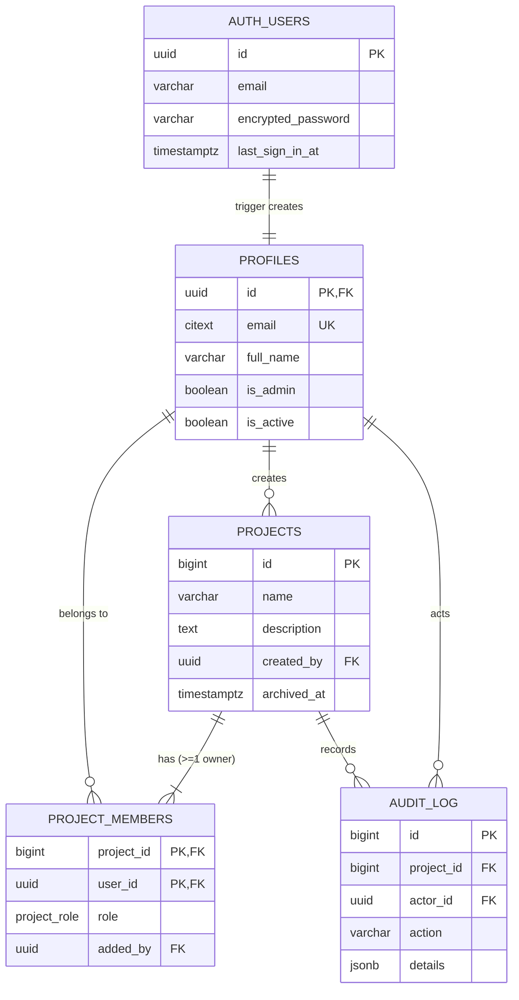
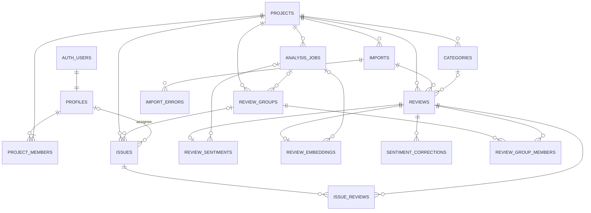

# ReviewRadar – Database ERD

DDL: [schema.sql](schema.sql). Supabase Postgres. `auth.users` is managed by Supabase Auth; the app owns everything in `public`.

## Sprint 1 – authentication, projects, roles

## Full model

## Key decisions

| Decision | Reason |
|----------|--------|
| Roles live on `project_members`, not on `profiles` | A user can be owner in one project and viewer in another (FR09). |
| Supabase Auth owns accounts (`auth.users`) | Passwords, reset and sessions are not implemented by the team. |
| `profiles` 1:1 with `auth.users`, filled by trigger | App tables reference `profiles(id)` (UUID); email copied for member lookup. |
| `profiles.is_admin` is the only global role | Platform admin manages users and can recover projects with no owner. |
| RLS enabled on all `public` tables, no policies | The public anon key cannot read app data through the Supabase Data API; FastAPI is the only reader. |
| `UNIQUE (project_id, content_hash)` on `reviews` | Exact duplicates rejected at DB level, re-importing a file is idempotent (FR04, NFR04). |
| `imports.file_sha256` | Warn the user when the same file is uploaded again. |
| `review_sentiments.predicted_label` + `final_label` | Keeps the AI estimate and the human correction separately (NFR05). |
| `projects.archived_at` soft delete | Project data is kept for audit; archived projects are hidden. |
| `audit_log` | Role changes and project actions are traceable (story #3, FR15). |
| Tables added per story | Sprint 1 migration contains only `profiles`, `projects`, `project_members`, `audit_log`. |
