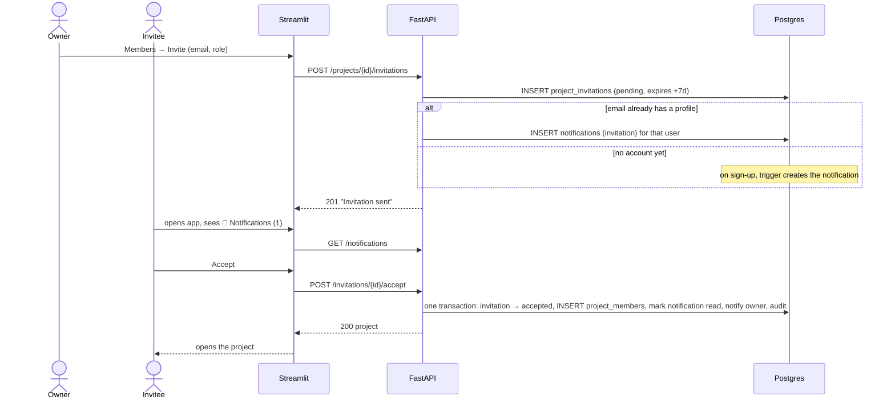

# ReviewRadar – Project Invitations and Notifications

Replaces "owner adds a member directly" (story #3, rule 3) with a GitHub-style flow:
the owner **invites** someone by email, the invitee sees the invitation in a **Notifications** tab and **accepts or declines** it. Only an accepted invitation creates a `project_members` row.

Builds on [auth-and-roles.md](auth-and-roles.md). Requirements: FR09, NFR01.

## 1. Goals

| Goal | How |
|------|-----|
| Nobody is added to a project without consent | Membership is created only when the invitee accepts. |
| Invite people who have no account yet | Invitations are stored by email; they appear after that email signs up. |
| One place for "things that need my attention" | A generic `notifications` table + Notifications page with an unread badge. Invitations are the first notification type; later stories (analysis finished, issue assigned) reuse it. |
| No email infrastructure needed | Delivery is in-app only. Sending an email is an optional later phase (section 9). |
| No account enumeration | Inviting any email returns the same response whether or not an account exists. |

## 2. User flow



Decline marks the invitation `declined` and notifies the inviter. The owner can **revoke** a pending invitation at any time; the invitee's notification then shows "Invitation no longer available" and the buttons disappear.

## 3. Business rules

1. Only users with `members.manage` (owners) can create, list and revoke invitations. Archived projects cannot invite.
2. An invitation targets an **email + role**. The email is normalised (trim, case-insensitive via `citext`).
3. Inviting an email that already belongs to a **member** → `409 "Already a member"`.
4. At most **one pending invitation per (project, email)**. Inviting again → `409 "Already invited — revoke the pending invitation to change the role"`.
5. Invitations **expire after 7 days**. Expiry is checked at read/accept time (`expires_at <= now()` ⇒ reported as `expired`, and stored as `expired` the next time someone tries to accept it or re-invites the email); no background job.
6. Only the logged-in user whose `profiles.email` equals the invitation email can accept or decline it. Anyone else gets `404` (does not reveal the invitation exists).
7. Accept succeeds only if the invitation is `pending`, not expired, and the project is not archived; otherwise `409` with a clear message ("expired", "revoked", "project archived").
8. Accept is **one transaction**: invitation `accepted` + `responded_at`, `project_members` insert (`added_by = invited_by`), notification marked read, "accepted" notification for the inviter, audit rows. If the user is somehow already a member, the invitation is just closed (idempotent).
9. Inviting an unknown email returns the same `201` as a known one (no enumeration). The pending list shows the email either way.
10. Every invitation change is audited: `invitation.created`, `invitation.revoked`, `invitation.accepted` (plus the existing `member.added`), `invitation.declined`.
11. Direct add (`POST /projects/{id}/members`) is **removed**. Role changes, removal and leaving stay as they are.

### Security note
"Confirm email" is currently **off** ([auth-and-roles.md §4](auth-and-roles.md#4-authentication-supabase-auth)), so Supabase does not prove that a user owns their email. Anyone could sign up as `alice@example.com` and accept Alice's invitation. This is the same trust level as today's add-by-email and is acceptable for the lab demo; **before real use, turn on email confirmation** (or ship phase 2's emailed invite link) so that matching by email is trustworthy.

## 4. Database

New migration `supabase/migrations/20261107000000_invitations_notifications.sql`.

```sql
CREATE TYPE invitation_status AS ENUM ('pending', 'accepted', 'declined', 'revoked', 'expired');

CREATE TABLE project_invitations (
    id            BIGINT GENERATED ALWAYS AS IDENTITY PRIMARY KEY,
    project_id    BIGINT            NOT NULL REFERENCES projects(id) ON DELETE CASCADE,
    email         CITEXT            NOT NULL,
    role          project_role      NOT NULL,
    status        invitation_status NOT NULL DEFAULT 'pending',
    invited_by    UUID              REFERENCES profiles(id) ON DELETE SET NULL,
    responded_by  UUID              REFERENCES profiles(id) ON DELETE SET NULL,
    created_at    TIMESTAMPTZ       NOT NULL DEFAULT now(),
    expires_at    TIMESTAMPTZ       NOT NULL DEFAULT now() + interval '7 days',
    responded_at  TIMESTAMPTZ
);

-- rule 4: one pending invitation per project + email
CREATE UNIQUE INDEX uq_invitations_pending
    ON project_invitations (project_id, email) WHERE status = 'pending';
CREATE INDEX ix_invitations_email ON project_invitations (email) WHERE status = 'pending';

CREATE TABLE notifications (
    id            BIGINT GENERATED ALWAYS AS IDENTITY PRIMARY KEY,
    user_id       UUID         NOT NULL REFERENCES profiles(id) ON DELETE CASCADE,
    type          VARCHAR(40)  NOT NULL,  -- 'invitation', 'invitation.accepted', 'invitation.declined', later: 'analysis.finished', ...
    project_id    BIGINT       REFERENCES projects(id) ON DELETE CASCADE,
    invitation_id BIGINT       REFERENCES project_invitations(id) ON DELETE CASCADE,
    actor_id      UUID         REFERENCES profiles(id) ON DELETE SET NULL,
    payload       JSONB,                  -- display data: project name, role, actor name
    read_at       TIMESTAMPTZ,
    created_at    TIMESTAMPTZ  NOT NULL DEFAULT now()
);

CREATE INDEX ix_notifications_user ON notifications (user_id, created_at DESC);
CREATE INDEX ix_notifications_unread ON notifications (user_id) WHERE read_at IS NULL;

ALTER TABLE project_invitations ENABLE ROW LEVEL SECURITY;
ALTER TABLE notifications       ENABLE ROW LEVEL SECURITY;
```

Invitations for emails that sign up later: `deliver_pending_invitations()` runs `AFTER INSERT ON profiles` and `AFTER UPDATE OF email ON profiles`, and inserts one `notifications` row per pending, non-expired invitation whose `email = NEW.email` (skipping archived projects and invitations already delivered to that user).

Also update `docs/database/schema.sql` and `docs/database/erd.md`.

## 5. API

| Method | Path | Permission | Notes |
|--------|------|-----------|-------|
| POST | `/projects/{id}/invitations` | `members.manage` | body `{email, role}` → `201 InvitationOut`; 409 per rules 3–4 |
| GET | `/projects/{id}/invitations` | `members.manage` | pending (incl. expired, flagged) invitations |
| DELETE | `/projects/{id}/invitations/{inv_id}` | `members.manage` | revoke → `204`; 409 if not pending |
| GET | `/notifications` | authenticated | `?unread=true`, newest first, limit 50. Invitation items include live `invitation_status` (`pending`/`expired`/`accepted`/…) so stale buttons are hidden |
| GET | `/notifications/unread-count` | authenticated | `{count}` for the badge — cheap, called on every page |
| POST | `/notifications/{id}/read` | owner of notification | `204` |
| POST | `/notifications/read-all` | authenticated | `204` |
| POST | `/invitations/{id}/accept` | invitee (rule 6) | `200 ProjectOut` |
| POST | `/invitations/{id}/decline` | invitee (rule 6) | `204` |
| ~~POST~~ | ~~`/projects/{id}/members`~~ | – | removed (rule 11) |

Code layout:

```
backend/app/
├── invitations/
│   ├── router.py     # project-scoped + /invitations/{id}/accept|decline
│   └── service.py    # rules 1–10, uses projects.service._audit
└── notifications/
    ├── router.py
    └── service.py    # notify(db, user_id, type, **payload) — reused by later stories
```

`invitations` is added to `PERMISSIONS` under the existing `members.manage` key — no new permission.

## 6. Frontend (Streamlit)

**Notifications page** – new `frontend/pages/3_Notifications.py`, modelled on GitHub's inbox:

```
🔔 Notifications                         [Mark all as read]
[ Unread | All ]
┌──────────────────────────────────────────────────────────┐
│ ● Alex invited you to join **Mobile App Reviews**        │
│   as Analyst · 2 hours ago · expires in 6 days           │
│                                    [Accept]  [Decline]   │
├──────────────────────────────────────────────────────────┤
│   Maria accepted your invitation to **Web Reviews**      │
│   1 day ago                                [Open project]│
├──────────────────────────────────────────────────────────┤
│   Invitation to **Old Project** — expired                │
└──────────────────────────────────────────────────────────┘
```

- `●` marks unread; opening the page does **not** auto-mark everything read (like GitHub), clicking Accept/Decline/Open or "Mark as read" does.
- Accept → toast "You joined X", sets `st.session_state.project_id`, switches to the project page.
- Revoked/expired/already-answered invitations render as greyed text without buttons.

**Badge** – the sidebar page menu is hidden, so add a small header helper in `frontend/auth.py` (e.g. `nav_header()`) called by every page: shows `🔔 Notifications (N)` button using `/notifications/unread-count`, plus the existing back/logout controls. The count refreshes on every Streamlit rerun; no realtime/polling needed.

**Project page** (`2_Project.py`):
- "Add member" form becomes **Invite member** (email + role → `POST /invitations`), toast "Invitation sent to …".
- New **Pending invitations** list under Members: email, role, invited by, expires/expired, **Revoke** button.
- Keep the generic error for unknown emails (no enumeration); show 409 messages verbatim.

## 7. Test plan (pytest)

| Area | Cases |
|------|-------|
| Create | owner invites → 201 + pending row + notification for existing user; unknown email → same 201, no notification; non-owner → 403; non-member → 404; archived project → 409; already member → 409; duplicate pending → 409; email case-insensitive |
| Sign-up trigger | pending invitation exists → new user gets a notification on sign-up (integration, local Supabase) |
| Accept | creates member with invited role; invitation `accepted`; inviter notified; audit rows; wrong user → 404; expired → 409; revoked → 409; archived project → 409; already accepted → 409; already member → idempotent |
| Decline | status `declined`, no membership, inviter notified |
| Revoke | owner revokes pending → `revoked`; revoke non-pending → 409; invitee's notification shows `revoked`, accept → 409 |
| Notifications | list only own; unread filter; unread-count; mark one / all read; cannot mark another user's → 404 |
| Removed endpoint | `POST /projects/{id}/members` → 404/405 |
| Re-invite | after decline/revoke/expiry, a new invitation can be created |

## 8. Tasks

| Task | Approach |
|------|----------|
| Migration: `project_invitations`, `notifications`, sign-up / email-change triggers, RLS | – |
| ORM models + Pydantic schemas (`InvitationOut`, `NotificationOut`) | – |
| `notifications` service + router | TDD |
| `invitations` service: create / list / revoke | TDD |
| Accept / decline in one transaction | TDD |
| Remove direct add endpoint, update existing tests | TDD |
| Notifications page + badge header | Pair programming |
| Project page: invite form + pending invitations | Pair programming |
| Update `auth-and-roles.md` (rule 3, API table, acceptance criteria), `schema.sql`, `erd.md` | – |

Order: migration → notifications service → invitations service → accept/decline → UI.

## 9. Later (out of scope now)

- **Email delivery**: on invite, call Supabase `auth.admin.invite_user_by_email` (server-side, `SUPABASE_SECRET_KEY`) for new emails, or send a plain notification email via SMTP for existing users. Needs SMTP config (Mailpit locally).
- **Shareable invite link** with a one-time token, as an alternative proof of email ownership.
- **Resend / change role** of a pending invitation instead of revoke + re-invite.
- Other notification types: analysis finished/failed, issue assigned, role changed, removed from project.

## 10. Acceptance criteria

- An owner can invite an email with a role; the invitee is **not** a member until they accept.
- The invitee sees an unread badge and the invitation in the Notifications tab, with Accept and Decline.
- Accepting makes them a member with the invited role and opens the project; declining does not.
- The owner sees pending invitations and can revoke them; a revoked or expired invitation can no longer be accepted.
- Inviting an email without an account works; the invitation appears after that email signs up.
- The inviter is notified when an invitation is accepted or declined.
- The UI and API never reveal whether an email has an account.
- Every invitation action is recorded in the audit log.
